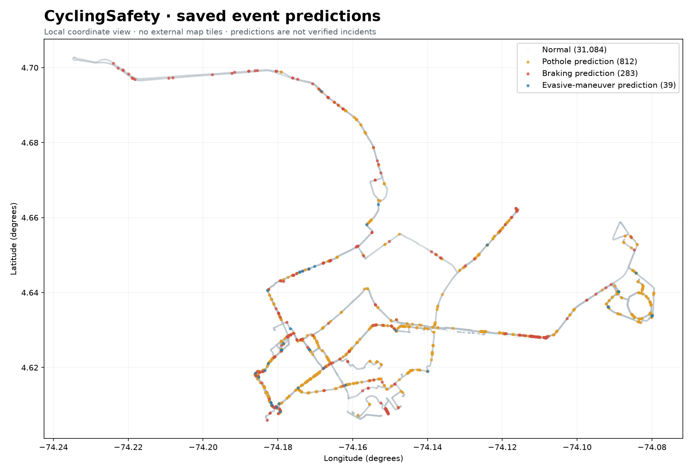
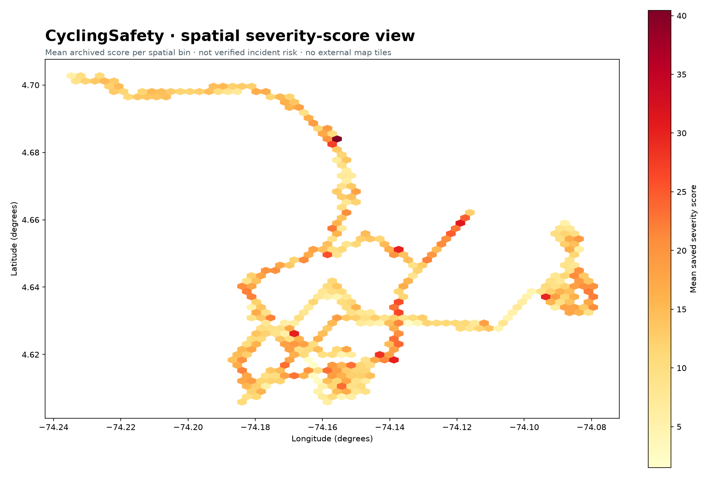
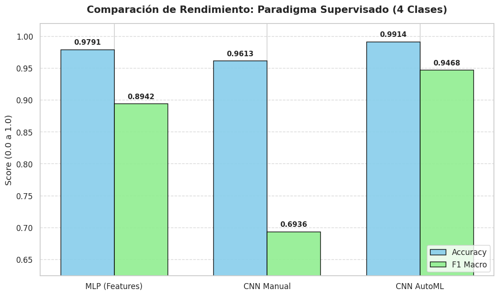
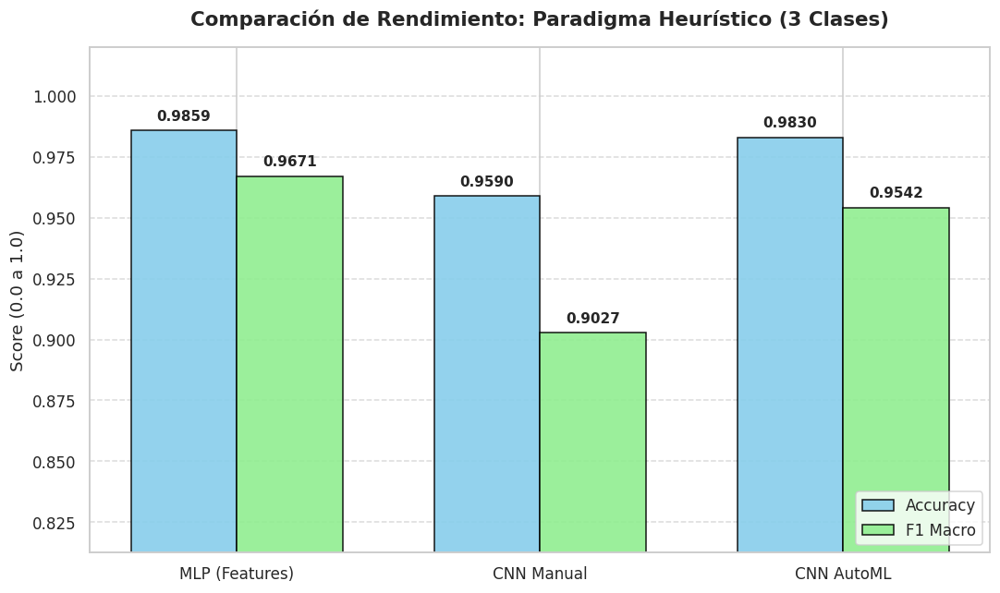
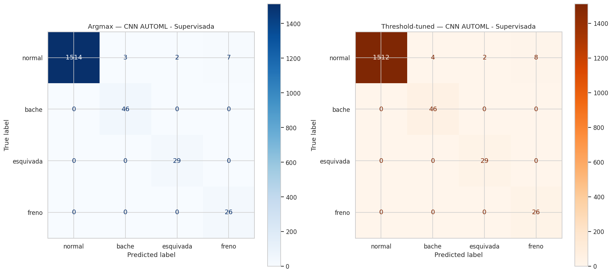

# Maps and model figures

## Predicted event locations

The preview is generated from the existing prediction CSV without external map tiles. It shows model outputs, not independently verified incidents.

Interactive HTML files:

- [Combined layers](../outputs/map_combined.html)
- [Classified-event map](../outputs/map_mlp_events.html)
- [Severity heatmap](../outputs/map_severity_heatmap.html)

Download and open the HTML files in a browser to interact with them. They use the original Folium scripts and map-tile services.

## Severity-score preview

This local preview averages the archived severity score within spatial bins. It uses no external basemap and should not be interpreted as a verified incident-risk map.

## Supervised model comparison

This original notebook figure compares saved MLP, manual CNN and KerasTuner CNN results. The window-based split and augmentation leakage described in [REVIEW.md](REVIEW.md) limit interpretation of the scores.

## Heuristic model comparison

The heuristic task has three classes and is distinct from the manually supervised four-class problem.

## Supervised CNN evaluation

The original figure includes argmax and threshold-adjusted evaluation views. Its saved title is retained; it is not evidence of an independent ride-level test. No model was retrained to create these images.
